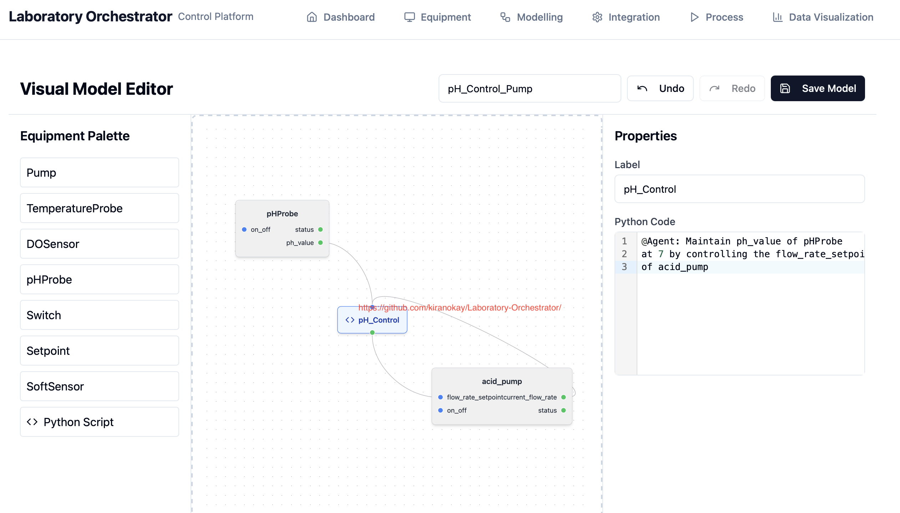
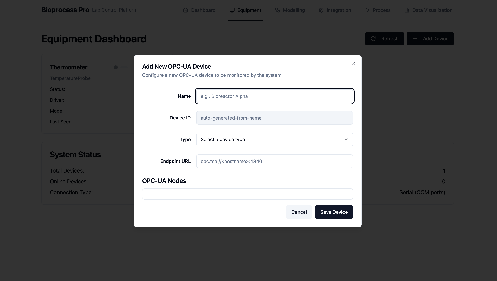

# Laboratory-Orchestrator

Visual of Labratory Orchestrator and Data Aggregator.

Showcasing:

* Visual Model Editor
* Automatic Python Code Generation
* Workflow
* Equipment Integration via OPC UA

  

  

Copyright © 2026 Rama Kiran Peesa. All Rights Reserved.
